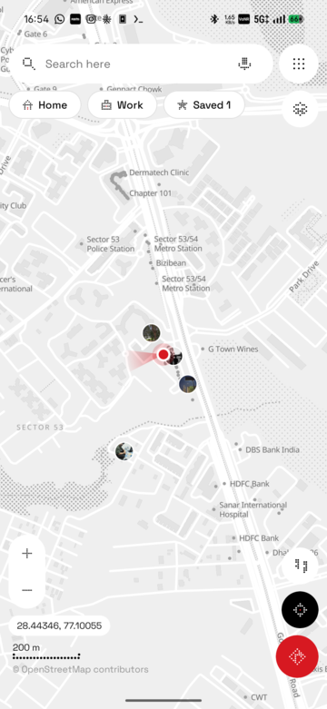
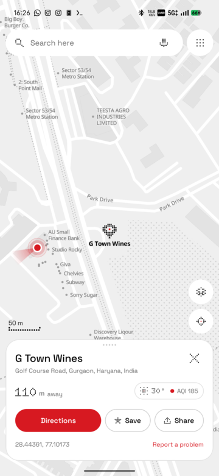
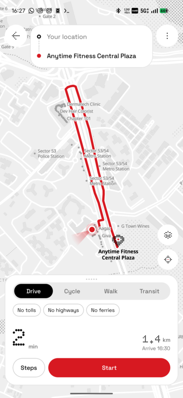
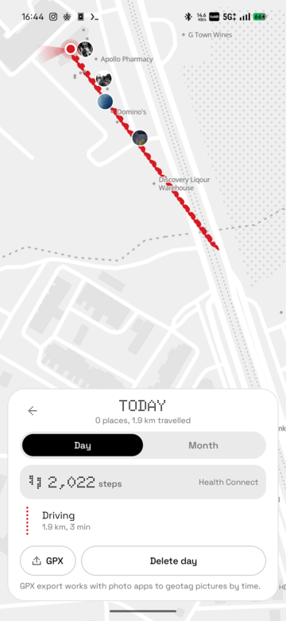
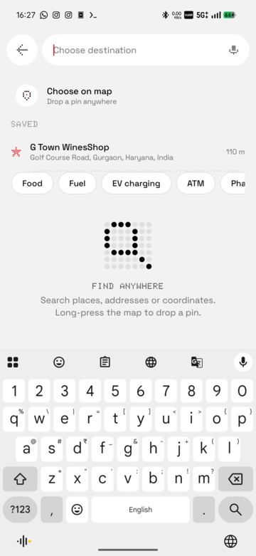
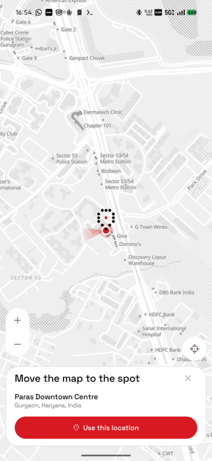
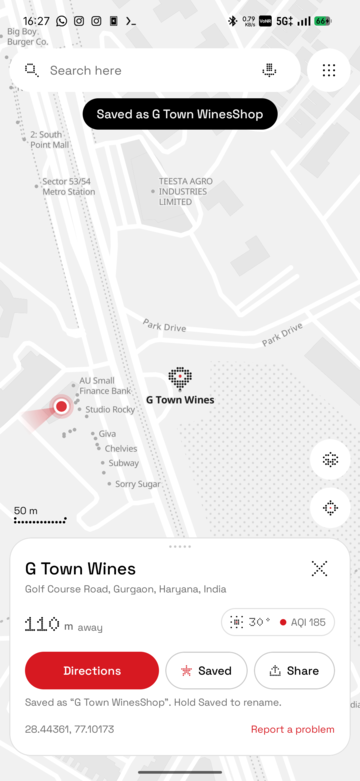
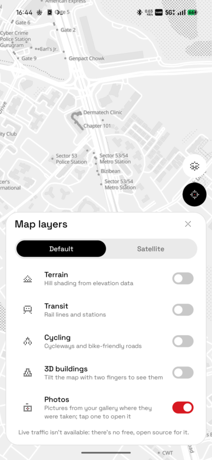

# Maps (NothingMaps)

A dot-matrix map app for Android in the Nothing OS style: monochrome tiles, red accents, Doto numerals. Every data source is open and keyless, and everything you save, record or keep in Timeline stays on the phone.

<p align="center">
  
  
  
  
</p>

## Features

**Map and search**
- Vector tiles from OpenFreeMap drawn as a dot-matrix style; satellite, terrain, transit, cycling and 3D-building layers.
- Search and reverse lookup by Photon; nearby categories from the map's own tiles (offline) and Overpass.
- Weather and air quality for whatever the map is looking at, and for every place you open: temperature with a sun / moon / cloud / rain / snow / storm glyph and the US AQI (Open-Meteo).
- Long-press to drop a pin; coordinates typed into search go straight to a pin.

**Directions and navigation**
- Driving, cycling, walking (OSRM) and public transit (Transitous), with up to five stops, alternatives, avoid tolls / highways / ferries, lane hints and flyover / underpass wording.
- Pick a start, stop or destination by searching, from Home / Work / saved places, or by dropping the pin anywhere on the map.
- Turn-by-turn with voice, speed limits from OpenStreetMap, rerouting, a lock-screen trip notification (Android 16 live update) and an automatic night map in the dark.
- Offline: download an area, then search, route and navigate on the phone with no connection.

**Places**
- Save a place with a name of your choosing; rename it later from the place sheet or the Saved screen; save as many as you like.
- Home and Work shortcuts, set from search, from a Timeline suggestion, or in Settings (where they can also be changed or removed).
- Parking spot, place sharing, "report a map problem" straight to OpenStreetMap notes.

**Timeline and activity**
- A private location history on the phone: visits and trips per day, a month summary, home / work suggestions, editable names and travel modes.
- Steps and workouts from Health Connect (where Google Fit, Samsung Health, Strava and the rest put their data) shown on each day; connect or disconnect in Settings.
- Record runs, rides and walks with auto-pause, cadence, barometric elevation and GPX export.
- GPX export of a Timeline day (to geotag pictures by time), of activities, and of saved places.

**Photos**
- A Photos layer shows geotagged gallery pictures as round thumbnails where they were taken. Tap one for the picture, the date, address, coordinates, size and camera / exposure details, with Directions, Open and Share.

**Sharing**
- Places and live location go out as the app's own links (`sutharshantanu.github.io/NothingMaps/?…`): they open in Maps when it's installed, and otherwise land on a page that sends people to the latest release to get it.
- Live location is end-to-end encrypted and relayed through ntfy.sh; follow friends' links on your own map.

<p align="center">
  
  
  
  
</p>

## Recently added

- Pin-drop and saved-place selection in the directions picker.
- Named saved places, renamable before and after saving.
- Weather and AQI badges (map centre and place sheet) with dot-matrix sky glyphs.
- Health Connect steps and workouts in Timeline, with connect / disconnect.
- Gallery photos on the map, with a photo sheet.
- GPX limited to activities, Timeline and saved places (track following removed from navigation).
- Map controls laid out like Google Maps: layers under the menu, zoom / coordinates / scale bottom-left, activity / my location / directions bottom-right.
- Home and Work editable and removable from Settings.

## Upcoming

- Photo clusters when many pictures share a spot, and a day's photos in the Timeline.
- Weather along a route and at the ETA, with rain warnings before a ride or walk.
- Health Connect: write recorded activities back, and show distance and calories per day.
- Saved-place lists (collections) and labels on the map.
- Speed cameras and incident reports from OpenStreetMap / community sources.
- Wear OS turn glyphs and a home-screen widget for the next trip.
- Localisation of the UI beyond English.

## Updates

The app checks GitHub Releases on launch (and from Settings → App → Check for updates). When a newer build exists it shows a banner; one tap downloads the APK inside the app and opens the installer. Builds are numbered by the CI run (`v1.0.0-build.N`), and every build is signed with the same key (repository secret `NMAPS_KEYSTORE_B64`, plus `NMAPS_KEYSTORE_PASSWORD`, `NMAPS_KEY_ALIAS`, `NMAPS_KEY_PASSWORD`) so updates install over each other.

## Share links

`docs/index.html` is the landing page for shared links, served by GitHub Pages from the `docs/` folder of `master`. On Android it opens the app through an `intent://` link with the release page as the fallback; elsewhere it shows the place on OpenStreetMap and the download link. The app also registers `https://sutharshantanu.github.io/NothingMaps/…` and `nmaps://open?…` so links open directly once Maps is installed.

## Building

Requirements: JDK 21, Android SDK with platform 36, and the Gradle wrapper (Gradle 9.6, AGP 9.4).

```bash
./gradlew :app:assembleDebug          # app/build/outputs/apk/debug/app-debug.apk
./gradlew :app:testDebugUnitTest      # unit tests
adb install -r app/build/outputs/apk/debug/app-debug.apk
```

The release build type is signed with the debug key on purpose: this is a personal app, not a store listing. CI builds both and attaches the APKs to a GitHub release for every successful build on `master`.

Optional: pass `-PosmApi=https://master.apis.dev.openstreetmap.org` to send map-problem reports to the OpenStreetMap sandbox.

## Permissions it asks for, and why

| Permission | Used for |
|---|---|
| Location (fine, background) | the map, navigation, recording, Timeline (background only when Timeline is on) |
| Activity recognition | step counter while recording |
| Notifications | navigation, recording and sharing status |
| Microphone | voice search |
| Photos and media location | the Photos layer (reads EXIF GPS from pictures) |
| Health Connect: read steps, read exercise | activity in Timeline |

## Data sources and credits

Map data © OpenStreetMap contributors · Tiles © OpenFreeMap, OpenMapTiles · Imagery © Esri · Terrain: Mapzen / AWS Open Data · Search: Photon (komoot) · Routing: OSRM (FOSSGIS) · Transit: Transitous · Weather and air quality: Open-Meteo · Relay: ntfy.sh · Map engine: MapLibre.
